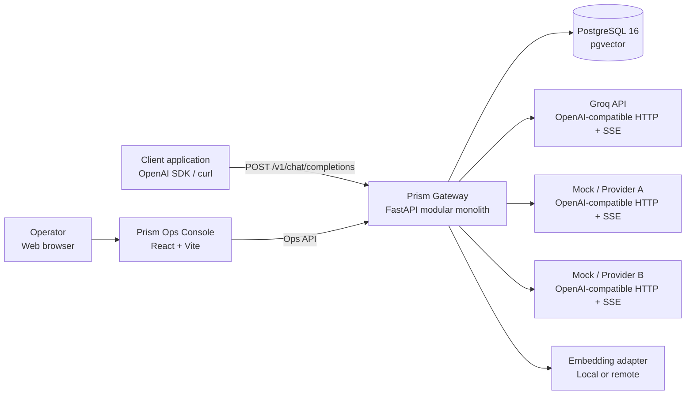
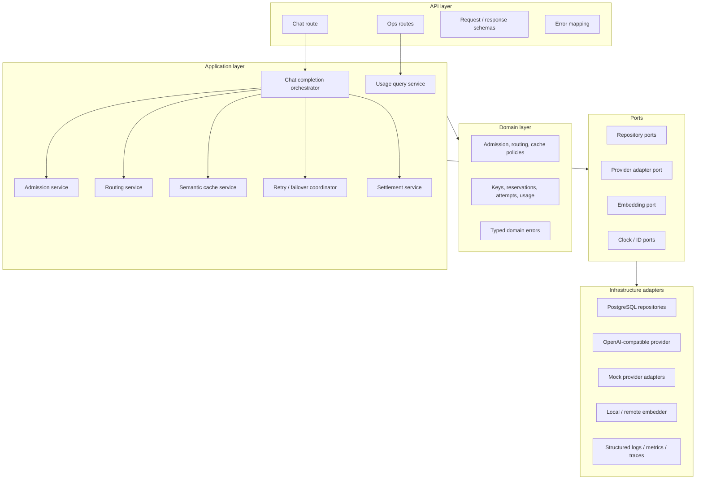
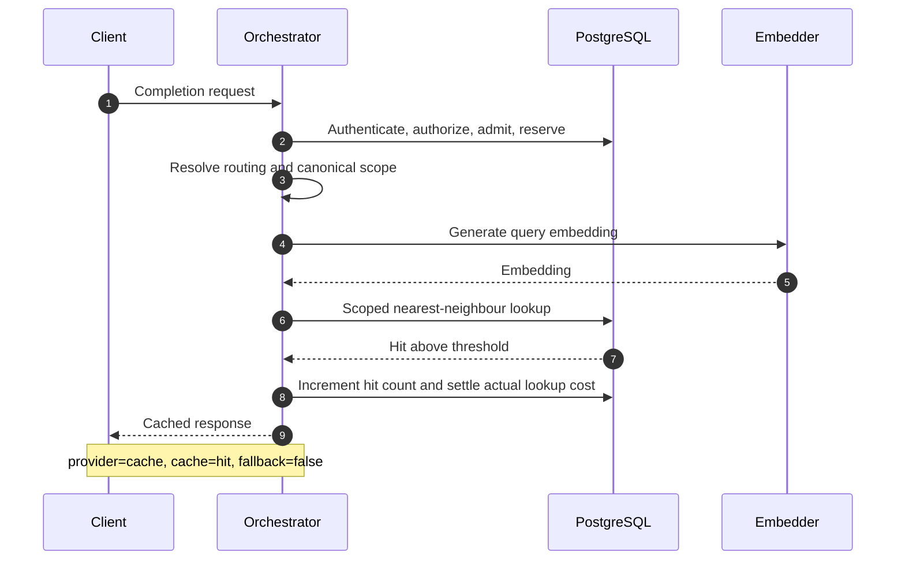
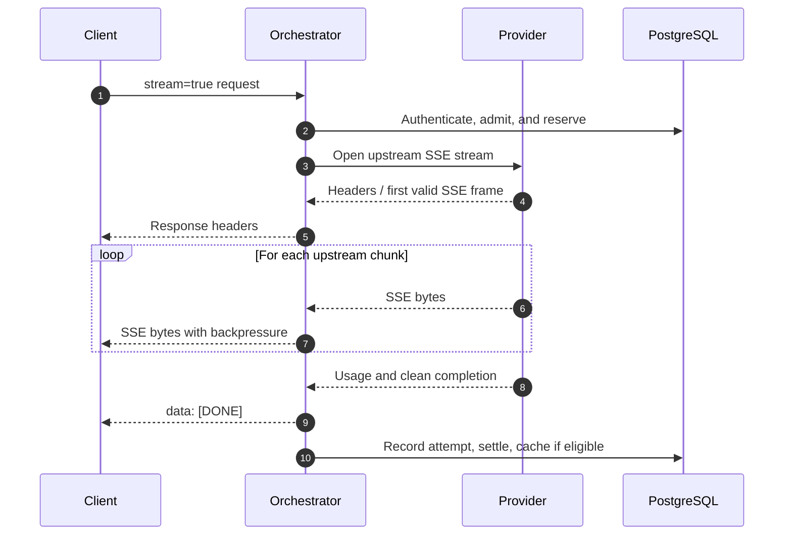
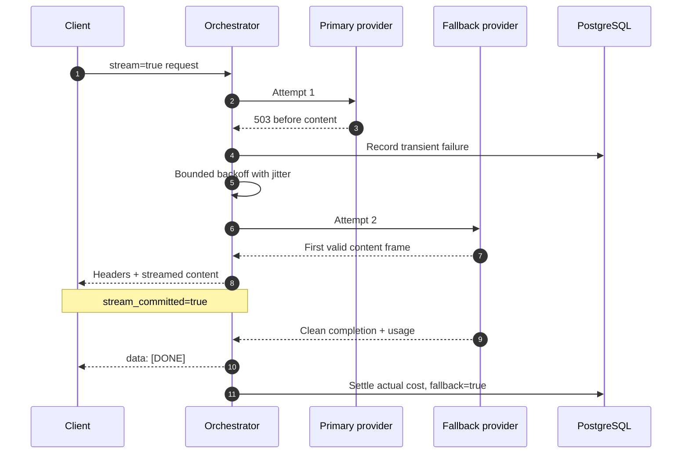
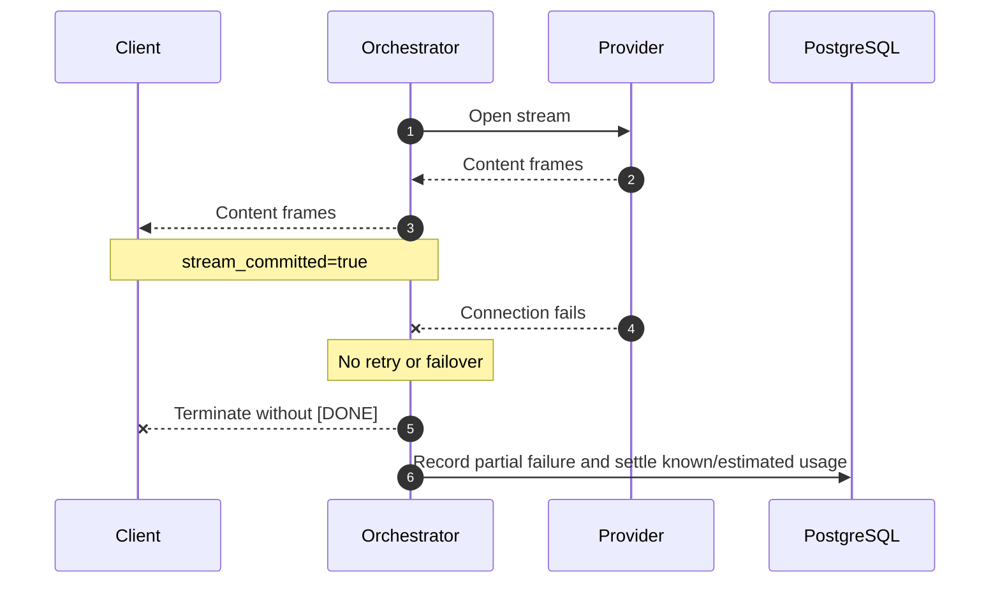
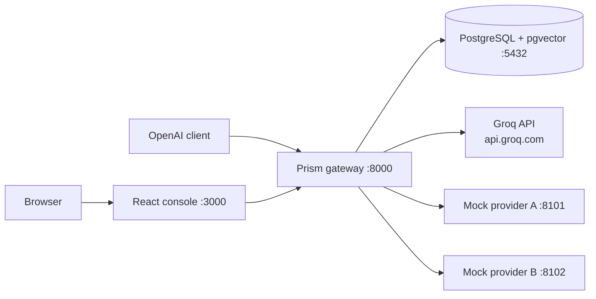

# Architecture — Prism LLM Gateway and Semantic Cache

> **Status:** Accepted for implementation  
> **Architecture style:** Modular monolith with ports and adapters  
> **Primary runtime:** Python 3.12+, FastAPI, asyncio, HTTPX  
> **Primary datastore:** PostgreSQL 16 with pgvector  
> **Frontend:** React + Vite operations console

---

## 1. Purpose

This document turns the selected high-level design into an implementation-ready architecture. It defines component boundaries, request flows, concurrency rules, failure behaviour, security controls, deployment topology, and the intended source-code structure.

Prism is an OpenAI-compatible, multi-tenant LLM gateway. It provides one stable API in front of multiple upstream model providers while enforcing authentication, model access, rate limits, budgets, routing, retries, failover, streaming, semantic caching, accounting, and operational visibility.

The central design goal is **correctness before distribution**. Prism starts as one independently testable backend service with strong internal module boundaries and PostgreSQL as its transactional source of truth. The boundaries allow selected modules to become separate services later without requiring a rewrite of the domain rules.

---

## 2. Architecture Decision

### 2.1 Selected approach

Prism uses a **modular monolith with ports and adapters**, refining Approach A from `HLD.md`.

- **Modular monolith:** one backend deployment, divided into cohesive business modules.
- **Ports and adapters:** application code depends on interfaces; PostgreSQL, embeddings, and providers implement those interfaces.
- **Asynchronous data plane:** provider calls, streaming, and database access use non-blocking APIs.
- **PostgreSQL source of truth:** keys, configuration, budget state, reservations, logs, and cache metadata are stored transactionally.
- **Groq-backed data plane with deterministic mocks:** Groq serves normal `fast` and `smart` traffic through the OpenAI-compatible adapter; two independent HTTP mocks preserve reproducible timeout, retry, fallback, and SSE fault tests.

### 2.2 Why this approach

This architecture provides:

1. Direct ownership of assessment-critical behaviour.
2. A complete request path that can be explained and demonstrated.
3. Atomic admission and accounting without distributed transactions.
4. Explicit interfaces for replacing providers and embedding engines.
5. Focused unit, integration, contract, concurrency, and end-to-end tests.
6. A safe path to multiple application instances because coordination occurs in PostgreSQL.

### 2.3 Deliberately deferred

The first version does not include:

- Redis admission counters.
- A message broker or event bus.
- Separate data-plane and control-plane deployments.
- A dedicated vector database.
- LiteLLM as the gateway core.
- Asynchronous accounting that could acknowledge a response before durable settlement.

These may be reconsidered only after measured load or reliability evidence justifies the additional operational complexity.

---

## 3. System Context



### 3.1 Trust boundaries

| Boundary | Untrusted input | Required protection |
|---|---|---|
| Client → Gateway | Headers, JSON body, virtual key, prompts | Schema validation, authentication, size limits, allowlist enforcement |
| Console → Ops API | Admin token, filters, pagination | Separate admin authentication and authorization |
| Gateway → Provider | Provider response, SSE frames, usage fields | Timeouts, response validation, bounded buffering, error sanitization |
| Gateway → Embedder | Prompt material and embedding result | Timeout, dimensionality validation, tenant privacy policy |
| Gateway → PostgreSQL | Application queries | Parameterized SQL, short transactions, least-privilege role |

---

## 4. Logical Architecture



### 4.1 Dependency rule

Dependencies point inward:

```text
API → Application → Domain
             ↓
           Ports ← Adapters
```

- The domain layer imports no FastAPI, SQLAlchemy, HTTPX, or provider SDK code.
- The application layer coordinates use cases through ports.
- Adapters contain technology-specific code.
- The API layer translates HTTP into application commands and maps results back to OpenAI-compatible responses.

---

## 5. Component Responsibilities

### 5.1 API layer

#### Chat route

- Exposes `POST /v1/chat/completions`.
- Validates the request with Pydantic models.
- Extracts the bearer virtual key.
- Delegates the complete use case to the chat orchestrator.
- Returns JSON or `text/event-stream` without embedding business logic in the route.

Authentication is implemented as a FastAPI dependency or application service, not generic middleware, because model access decisions require the parsed request alias.

#### Ops routes

- Expose usage summaries, recent requests, cache statistics, and provider attempt data.
- Require administrator credentials distinct from tenant virtual keys.
- Use bounded pagination and indexed filters.
- Never return raw key hashes, provider credentials, prompt bodies, or unsanitized upstream errors.

#### Error mapping

Domain errors map to stable HTTP status codes and machine-readable codes:

| Condition | HTTP status | Error code |
|---|---:|---|
| Missing or invalid key | 401 | `invalid_api_key` |
| Inactive or expired key | 401 | `inactive_api_key` |
| Alias not allowed | 403 | `model_not_allowed` |
| RPM exceeded | 429 | `rate_limit_exceeded` |
| Budget exhausted | 402 | `budget_exhausted` |
| Invalid request | 400 or 422 | `invalid_request` |
| All providers unavailable | 503 | `provider_unavailable` |
| Upstream timeout | 504 | `provider_timeout` |

### 5.2 Chat completion orchestrator

The orchestrator owns the end-to-end lifecycle but delegates every policy or external action. It must guarantee that an admitted request reaches one terminal settlement path even when the client disconnects or an exception occurs.

Its responsibilities are:

1. Authenticate and authorize.
2. Calculate a conservative reservation.
3. Perform atomic admission.
4. Resolve routing.
5. Evaluate cache eligibility and perform lookup.
6. Coordinate the provider attempt chain.
7. Produce JSON or SSE output.
8. Settle accounting exactly once.
9. Write audit and attempt records.
10. Store eligible successful responses in cache.

### 5.3 Authentication service

- Converts the presented virtual key to an HMAC-SHA-256 digest using a server-side pepper.
- Looks up the digest with a unique index.
- Rejects inactive and expired keys.
- Never stores or logs the raw key.
- Exposes only the minimum tenant context needed by downstream services.

Plain SHA-256 remains acceptable only when seed compatibility requires it and the keys contain sufficient cryptographic entropy. The preferred production design is HMAC-SHA-256 so a database leak alone is insufficient for offline key verification.

### 5.4 Admission service

Admission combines RPM enforcement and budget reservation in one short database transaction for a single virtual key.

```text
BEGIN
  lock admission counter for key
  roll RPM window if required
  roll budget month if required
  reject if RPM limit reached
  reject if spent + reserved + estimate > budget
  increment RPM count
  increase reserved amount
  create pending reservation
  create in-progress request log
COMMIT
```

The transaction ends before classification, embedding, cache lookup, or provider network I/O.

#### Reservation estimate

The conservative estimate includes all billable work that may occur:

- Maximum input tokens for the selected request.
- Requested or configured maximum output tokens.
- The most expensive allowed provider in the fallback chain.
- Auto-routing classifier cost, if externally billed.
- Embedding cost, if externally billed.
- Bounded retries where the provider may charge failed attempts.

If the estimate itself exceeds the remaining budget, admission fails before billable work begins.

### 5.5 Routing service

The router accepts logical aliases: `fast`, `smart`, and `auto`.

- `fast` and `smart` resolve to configured primary and fallback targets.
- `auto` invokes a versioned difficulty classifier and resolves to `fast` or `smart`.
- The classifier returns a tier, reason code, confidence, and classifier version.
- Routing decisions are recorded for evaluation and debugging.
- The classifier is validated against labeled short-hard and long-trivial cases.

The `auto` alias is a routing policy and must not require its own provider or physical model.

### 5.6 Semantic cache service

The cache is strictly tenant scoped. Every lookup includes both:

```text
virtual_key_id = current tenant
scope_hash     = canonical generation context
```

#### Canonical scope

The scope hash is computed from deterministic serialization of all response-affecting context:

- Requested alias and resolved tier/model policy.
- Complete ordered conversation, including roles and content.
- System and developer instructions.
- Temperature, `top_p`, maximum tokens, stop sequences, and seed.
- Tools, tool choice, response format, and relevant provider options.
- Cache schema version and embedding model version.

The `stream` flag is excluded because it changes transport, not response meaning.

#### Initial search strategy

The initial capstone implementation uses an exact cosine-distance search after filtering by tenant, scope, and expiry. This provides deterministic recall and is appropriate for a small cache.

HNSW may be introduced only after the cache is large enough to justify approximate search. Filtered ANN must use measured recall, iterative scans, or tenant-aware partitioning because a shared approximate index can under-return after tenant filters are applied.

#### Cache safety policy

Do not cache:

- Failed or partial responses.
- Incomplete streams.
- Tool-call responses in the initial version.
- Requests explicitly opting out of caching.
- Requests above the configured nondeterminism threshold.
- Responses containing content classified as non-cacheable by tenant policy.
- Usage records that could not be reconciled.

Cached non-streaming responses return JSON. Cached streaming requests are re-encoded as valid OpenAI-style SSE chunks and finish with `data: [DONE]`.

### 5.7 Provider adapter port

All upstream providers implement the same interface conceptually:

```python
class ProviderAdapter(Protocol):
    name: str

    async def complete(self, request: ProviderRequest) -> ProviderResponse: ...

    async def stream(self, request: ProviderRequest) -> ProviderStream: ...
```

Adapters are responsible for:

- Authentication to their provider.
- Translating the canonical request into provider format.
- Translating responses and usage into canonical models.
- Mapping provider errors to typed transient or fatal errors.
- Enforcing connect, read, write, and pool timeouts.
- Closing streaming responses on success, failure, or cancellation.

The application owns retry and failover policy. Provider adapters do not silently retry, because hidden retries make attempt logging and cost accounting unreliable.

### 5.8 Retry and failover coordinator

The coordinator walks an ordered chain of provider targets.

Retryable conditions:

- Connection failure.
- Configured read timeout before stream commitment.
- HTTP 408, 429, and selected 5xx responses.
- Explicit transient provider error.

Non-retryable conditions:

- Invalid gateway request.
- Provider authentication or configuration failure.
- Content-policy rejection unless the fallback policy explicitly permits it.
- Any upstream failure after client-visible streaming content has been emitted.

Retries use bounded exponential backoff with jitter. Every physical provider call creates a `provider_attempts` record.

#### Stream commitment rule

The gateway tracks a boolean `stream_committed`:

- `false`: no response content has reached the client; retry or failover is permitted.
- `true`: at least one content-bearing SSE frame has reached the client; retry and failover are forbidden.

After commitment, an upstream failure terminates the client stream without `[DONE]`, records a partial-stream error, and settles any known or estimated usage.

### 5.9 Settlement service

Settlement is an idempotent state transition performed in a short transaction.

```text
pending → settled
pending → failed
pending → cancelled
```

Only the first transition from `pending` may modify the admission counter. A conditional update or row lock prevents duplicate charges from overlapping completion, disconnect, and exception handlers.

On successful settlement:

```text
reserved_usd = reserved_usd - reservation_amount
spent_usd    = spent_usd + actual_cost
```

On a non-billable failure or cancellation, the reservation is released. If exact usage is unknown after a partial stream, the record is marked for reconciliation and a conservative configured cost is applied rather than silently charging zero.

### 5.10 Reservation reconciler

A periodic in-process task finds pending reservations older than a configured threshold.

- It acquires a PostgreSQL advisory lock so only one application instance performs reconciliation.
- It resolves reservations from durable request and attempt evidence.
- It releases clearly abandoned non-billable reservations.
- It flags ambiguous billable attempts for operator review.
- It records every automated reconciliation action.

This prevents process crashes from permanently consuming a tenant's available budget.

### 5.11 Observability

The gateway emits:

- Structured JSON logs with request, reservation, tenant, and attempt identifiers.
- Metrics for request count, latency, cache results, provider outcomes, fallbacks, active streams, and settlement failures.
- Trace spans across admission, routing, embedding, cache, provider attempts, and settlement.
- Health endpoints distinguishing liveness from dependency readiness.

Prompts, raw keys, authorization headers, provider credentials, and full upstream error bodies are excluded from normal logs.

---

## 6. Request Flows

### 6.1 Non-streaming cache miss

```mermaid
sequenceDiagram
    autonumber
    participant C as Client
    participant API as FastAPI
    participant O as Orchestrator
    participant DB as PostgreSQL
    participant R as Router
    participant E as Embedder
    participant P as Provider

    C->>API: POST /v1/chat/completions
    API->>O: Validated request + bearer key
    O->>DB: Authenticate key and check alias
    O->>DB: BEGIN; lock counter; admit + reserve; COMMIT
    O->>R: Resolve alias / classify auto
    R-->>O: Resolved tier and target chain
    O->>E: Embed canonical conversation
    E-->>O: Validated embedding
    O->>DB: Tenant + scope filtered cache lookup
    DB-->>O: Miss
    O->>P: Non-streaming completion
    P-->>O: Response + usage
    O->>DB: Record attempt and settle exactly once
    O->>DB: Store eligible cache entry
    O-->>API: Canonical response + Prism metadata
    API-->>C: 200 JSON + x-prism-* headers
```

### 6.2 Cache hit



### 6.3 Streaming pass-through



The gateway never buffers the complete provider response before forwarding it. If the client disconnects, the gateway cancels and closes the upstream stream, then executes settlement in cleanup logic.

### 6.4 Failover before stream commitment



### 6.5 Failure after stream commitment



### 6.6 Budget rejection

```mermaid
sequenceDiagram
    autonumber
    participant C as Client
    participant O as Orchestrator
    participant DB as PostgreSQL

    C->>O: Completion request
    O->>DB: Authenticate key
    O->>DB: BEGIN; SELECT counter FOR UPDATE
    DB-->>O: spent + reserved + estimate > limit
    O->>DB: Record rejection; COMMIT
    O-->>C: 402 budget_exhausted
    Note over O,C: No embedding or provider call occurs
```

---

## 7. API Contract

### 7.1 Chat endpoint

```text
POST /v1/chat/completions
Authorization: Bearer <virtual-key>
Content-Type: application/json
```

The request and response follow the supported subset of the OpenAI chat-completions contract. Unsupported fields return a clear validation error rather than being silently ignored.

### 7.2 Prism response headers

Every completion response includes:

| Header | Meaning |
|---|---|
| `x-prism-provider` | Provider that produced the response, or `cache` |
| `x-prism-cache` | `hit` or `miss` |
| `x-prism-fallback` | Whether a fallback provider served the request |
| `x-prism-cost-usd` | Actual cost for completed non-streaming responses; reserved estimate for streaming headers |
| `x-prism-request-id` | Correlation identifier safe to share with operators |

Because HTTP response headers precede a stream's final usage, `x-prism-cost-usd` is explicitly an estimate for streaming responses. Actual cost is persisted after the stream and exposed through authorized usage APIs.

### 7.3 SSE contract

- Content type: `text/event-stream`.
- Each message uses `data: <JSON>\n\n`.
- Successful completion ends with `data: [DONE]\n\n`.
- Partial or failed streams do not emit `[DONE]`.
- Cache hits requested with `stream=true` are transformed into the same SSE contract.

---

## 8. Data and Transaction Architecture

### 8.1 Transaction boundaries

| Operation | Transaction rule |
|---|---|
| Authentication lookup | Read-only query |
| Admission | Short transaction with one tenant counter row locked |
| Provider call | No database transaction or lock held |
| Attempt logging | Short independent transaction |
| Settlement | Short idempotent transaction locking reservation/counter |
| Cache lookup | Read-only query |
| Cache insert | Short independent transaction after successful response |
| Ops queries | Read-only, paginated queries |

### 8.2 Required data-model refinements

Before migrations are finalized, `DataModel.md` must incorporate these architecture requirements:

1. Allow invalid-key attempts to be logged without a `virtual_keys` foreign key, or create a separate security-events table.
2. Add `in_progress` and `partial_stream_error` request states.
3. Add idempotent settlement fields or constraints to reservations.
4. Add reconciliation metadata such as `reconciliation_required`, `last_error`, and timestamps.
5. Model alias permissions with a junction table if database referential integrity is required.
6. Treat `auto` as a routing policy instead of requiring a primary provider.
7. Store cache schema and embedding model versions.
8. Add a safe request fingerprint rather than storing complete prompts in request logs.
9. Define foreign keys for cache references after resolving creation-order cycles.

### 8.3 Monetary precision

- All monetary calculations use `Decimal` in Python.
- PostgreSQL uses `NUMERIC`, never floating-point types, for money.
- Pricing records are versioned by effective time.
- The price version used by each request is recoverable for audit.

### 8.4 Time

- PostgreSQL stores `TIMESTAMPTZ` in UTC.
- Application code uses timezone-aware UTC timestamps.
- A clock port allows deterministic tests for RPM and monthly rollovers.

---

## 9. Security Architecture

### 9.1 Credentials

- Provider secret values exist only in environment variables or a secret manager.
- Database rows store provider secret references, never secret values.
- Raw virtual keys are displayed only at creation or loaded from approved seed files.
- Logs redact authorization headers and known secret patterns.

### 9.2 Tenant isolation

Every tenant-owned query includes `virtual_key_id` as an explicit predicate. Repository APIs require tenant context so callers cannot accidentally perform an unscoped cache or usage query.

Tests must prove:

- Tenant A cannot read Tenant B's cache entries.
- Tenant A cannot read Tenant B's usage.
- Identical prompts under different keys never share cached responses.
- Different system instructions or tools never share a cache entry.

### 9.3 Input and resource limits

- Maximum request-body size.
- Maximum message and tool counts.
- Maximum individual content length.
- Maximum requested output tokens.
- Bounded provider response headers and error bodies.
- Database statement and lock timeouts.
- HTTP connect, read, write, and pool timeouts.
- Bounded retry count and total attempt duration.

### 9.4 Ops console

- Uses separate admin authentication.
- Applies an explicit CORS allowlist.
- Does not expose provider secrets or complete virtual-key hashes.
- Escapes all displayed content.
- Uses pagination for request history.

---

## 10. Deployment Architecture

### 10.1 Local and demonstration deployment



Docker Compose runs:

1. PostgreSQL with pgvector.
2. Prism gateway.
3. Mock Provider A.
4. Mock Provider B.
5. React console.

Normal `fast` and `smart` requests leave the Compose network through the gateway and authenticate to Groq with `GROQ_API_KEY`. The secret exists only in the gateway environment. Clients continue to authenticate to Prism with tenant-scoped virtual keys.

Separate mock provider processes are intentional: they test genuine HTTP streaming, timeouts, connection failures, and failover rather than bypassing the network stack with in-process mocks.

### 10.2 Scale-out path

Multiple stateless Prism instances may run behind a load balancer. PostgreSQL coordinates admissions and settlements. No in-memory state is authoritative.

Before scaling out:

- Verify database connection-pool sizing across all instances.
- Use an advisory lock for singleton reconciliation work.
- Keep routing and pricing configuration versioned and consistent.
- Export centralized logs, metrics, and traces.
- Load-test counter-row contention for hot tenants.

Redis should be introduced only if measurements show PostgreSQL RPM contention is unacceptable. Budget reservation remains authoritative in PostgreSQL.

---

## 11. Source-Code Structure

```text
CapstoneProjectAirtribe/
├── backend/
│   ├── pyproject.toml
│   └── src/prism/
│       ├── main.py
│       ├── api/
│       │   ├── dependencies.py
│       │   ├── errors.py
│       │   ├── schemas/
│       │   └── routes/
│       │       ├── chat.py
│       │       ├── health.py
│       │       └── ops.py
│       ├── application/
│       │   ├── chat_service.py
│       │   ├── admission_service.py
│       │   ├── routing_service.py
│       │   ├── cache_service.py
│       │   ├── provider_coordinator.py
│       │   └── settlement_service.py
│       ├── domain/
│       │   ├── models.py
│       │   ├── policies.py
│       │   └── errors.py
│       ├── ports/
│       │   ├── providers.py
│       │   ├── embeddings.py
│       │   ├── repositories.py
│       │   ├── clock.py
│       │   └── identifiers.py
│       ├── adapters/
│       │   ├── database/
│       │   │   ├── models.py
│       │   │   ├── repositories.py
│       │   │   └── session.py
│       │   ├── providers/
│       │   │   ├── openai_compatible.py
│       │   │   └── mocks.py
│       │   └── embeddings/
│       │       ├── local.py
│       │       └── remote.py
│       └── infrastructure/
│           ├── config.py
│           ├── logging.py
│           ├── metrics.py
│           └── lifecycle.py
├── frontend/
├── migrations/
├── config/
│   ├── model_pricing.json
│   ├── seed_keys.json
│   └── gateway_config.sample.json
├── mock-providers/
├── scripts/
├── tests/
│   ├── unit/
│   ├── integration/
│   ├── contract/
│   ├── concurrency/
│   └── end_to_end/
├── Docs/
├── docker-compose.yml
└── README.md
```

---

## 12. Testing Strategy

### 12.1 Unit tests

- Cost computation with decimal precision.
- Reservation estimation.
- Alias allowlist policy.
- Auto-routing classifier and baseline comparison.
- Retry classification and backoff bounds.
- Cache canonicalization and scope hashing.
- Similarity threshold decisions.
- Error mapping.

### 12.2 Integration tests

- PostgreSQL admission transactions.
- Monthly and RPM rollover.
- Idempotent settlement.
- Stale-reservation reconciliation.
- Tenant-filtered cache lookup.
- Repository pagination and filters.
- Database migrations and seed loading.

### 12.3 Provider contract tests

Every provider adapter is tested against the same suite:

- Successful non-streaming response.
- Successful SSE stream.
- Usage normalization.
- Timeout.
- Rate limit.
- Transient 5xx.
- Fatal 4xx.
- Malformed response.
- Disconnect before and after first content.

### 12.4 Concurrency tests

- Many simultaneous requests against one key never exceed the budget.
- RPM count does not lose updates.
- Settlement runs exactly once under competing cleanup paths.
- Separate tenants do not block one another unnecessarily.
- A crashed request is recovered by reconciliation.

### 12.5 End-to-end demonstrations

- OpenAI-compatible non-streaming completion.
- Token-by-token streaming ending with `[DONE]`.
- Smart routing for short-hard and long-trivial prompts.
- Primary failure followed by fallback success.
- Budget and RPM rejection without provider calls.
- Paraphrased semantic-cache hit.
- Proof of cross-tenant cache isolation.
- Ops console usage and recent-request views.

---

## 13. Operational Invariants

These rules are non-negotiable and should appear in code comments, tests, and review checklists:

1. **Never hold a database lock during external network I/O.**
2. **Never perform billable work before a successful reservation.**
3. **Never settle a reservation more than once.**
4. **Never query tenant-owned data without a tenant predicate.**
5. **Never retry or fail over after streaming commitment.**
6. **Never send `[DONE]` for an incomplete stream.**
7. **Never log raw keys, provider secrets, or authorization headers.**
8. **Never cache failed, partial, or context-incompatible responses.**
9. **Never use floating-point arithmetic for money.**
10. **Never let an upstream call run without a configured timeout.**

---

## 14. Implementation Order

1. Establish the backend package, configuration, lifecycle, and health endpoints.
2. Add PostgreSQL, migrations, seed loading, and repository foundations.
3. Implement virtual-key authentication and alias authorization.
4. Implement atomic admission, reservation, settlement, and concurrency tests.
5. Implement two HTTP mock providers and the provider adapter contract.
6. Implement non-streaming completion, retry, and failover.
7. Implement streaming pass-through, disconnect cleanup, and commitment rules.
8. Implement routing classifier and evaluation harness.
9. Implement exact semantic cache, canonical scoping, and isolation tests.
10. Implement usage APIs and the React operations console.
11. Add reconciliation, observability, load tests, smoke tests, and documentation.

Correct accounting and provider orchestration precede semantic caching and the frontend because they form the reliability foundation of the gateway.

---

## 15. Explanation Summary

Prism is a modular FastAPI gateway in front of multiple LLM providers. A request is authenticated and atomically admitted by reserving its worst-case cost in PostgreSQL. The gateway resolves the requested model alias, checks a tenant-isolated semantic cache, and calls providers through a common adapter when necessary. Retries and fallback are permitted only before streaming content reaches the client. Usage is then settled exactly once against the reservation, and the complete outcome is recorded for operations and auditing. PostgreSQL provides transactional correctness; internal ports keep providers, embeddings, and persistence replaceable; and the single-service deployment keeps the system understandable and demonstrable.

---

## 16. Related Documents

- [`problemStatement.md`](./problemStatement.md) — requirements and assessment criteria.
- [`HLD.md`](./HLD.md) — evaluated architecture alternatives.
- [`DataModel.md`](./DataModel.md) — initial relational and vector schema.
- [`KNOWLEDGE_TRANSFER.md`](./KNOWLEDGE_TRANSFER.md) — project state and agent handover.

