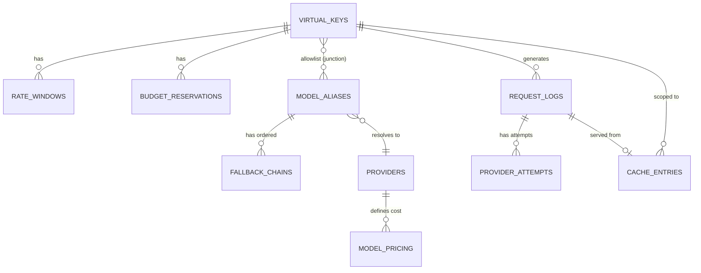

# Data Model — Prism: LLM Gateway and Semantic Cache

> All tables are PostgreSQL. The semantic cache uses `pgvector` for embedding storage and ANN similarity search. All monetary values are stored in **USD as `NUMERIC(12,8)`**. All timestamps are **`TIMESTAMPTZ` (UTC)**.

---

## Entity Relationship Overview



---

## Table Definitions

### 1. `providers`
Stores upstream LLM provider configurations. Provider credentials are **never** returned to callers.

```sql
CREATE TABLE providers (
    id              UUID PRIMARY KEY DEFAULT gen_random_uuid(),
    name            TEXT NOT NULL UNIQUE,          -- e.g. "openai", "anthropic", "mock-a"
    base_url        TEXT NOT NULL,                 -- e.g. "https://api.openai.com/v1"
    api_key_env_var TEXT NOT NULL,                 -- name of env var holding the real key
    timeout_ms      INTEGER NOT NULL DEFAULT 30000,
    is_active       BOOLEAN NOT NULL DEFAULT TRUE,
    created_at      TIMESTAMPTZ NOT NULL DEFAULT NOW(),
    updated_at      TIMESTAMPTZ NOT NULL DEFAULT NOW()
);
```

**Notes:**
- `api_key_env_var` holds the *name* of the env var (e.g., `OPENAI_API_KEY`), never the value.
- `timeout_ms` is the per-call deadline enforced by the provider adapter.

---

### 2. `model_aliases`
Defines the logical model names callers use (e.g., `fast`, `smart`, `auto`). Resolves to a primary provider + model.

```sql
CREATE TABLE model_aliases (
    id              UUID PRIMARY KEY DEFAULT gen_random_uuid(),
    alias           TEXT NOT NULL UNIQUE,          -- "fast" | "smart" | "auto" | "gpt-4o" etc.
    primary_provider_id UUID NOT NULL REFERENCES providers(id),
    primary_model   TEXT NOT NULL,                 -- actual model name on provider, e.g. "gpt-3.5-turbo"
    tier            TEXT NOT NULL                  -- "fast" | "smart" | "auto"
                    CHECK (tier IN ('fast', 'smart', 'auto')),
    max_input_tokens  INTEGER,                     -- bounds for cost reservation
    max_output_tokens INTEGER,
    is_active       BOOLEAN NOT NULL DEFAULT TRUE,
    created_at      TIMESTAMPTZ NOT NULL DEFAULT NOW()
);

-- Fallback chain: ordered list of (provider, model) per alias
CREATE TABLE fallback_chains (
    id              UUID PRIMARY KEY DEFAULT gen_random_uuid(),
    alias_id        UUID NOT NULL REFERENCES model_aliases(id) ON DELETE CASCADE,
    priority        INTEGER NOT NULL,              -- 1 = first fallback, 2 = second, ...
    provider_id     UUID NOT NULL REFERENCES providers(id),
    model           TEXT NOT NULL,
    created_at      TIMESTAMPTZ NOT NULL DEFAULT NOW(),
    UNIQUE (alias_id, priority)
);
```

**Notes:**
- `alias = "auto"` triggers the smart routing classifier; it still resolves to `fast` or `smart` tier at runtime.
- Fallback chain is ordered by `priority` ASC.

---

### 3. `model_pricing`
Price table loaded from `model_pricing.json`. Used for cost computation and budget reservation.

```sql
CREATE TABLE model_pricing (
    id                  UUID PRIMARY KEY DEFAULT gen_random_uuid(),
    provider_id         UUID NOT NULL REFERENCES providers(id),
    model               TEXT NOT NULL,
    input_cost_per_1k   NUMERIC(12,8) NOT NULL,    -- USD per 1,000 input tokens
    output_cost_per_1k  NUMERIC(12,8) NOT NULL,    -- USD per 1,000 output tokens
    effective_from      TIMESTAMPTZ NOT NULL DEFAULT NOW(),
    effective_until     TIMESTAMPTZ,               -- NULL = currently active
    created_at          TIMESTAMPTZ NOT NULL DEFAULT NOW(),
    UNIQUE (provider_id, model, effective_from)
);

CREATE INDEX idx_model_pricing_lookup
    ON model_pricing(provider_id, model)
    WHERE effective_until IS NULL;
```

---

### 4. `virtual_keys`
Core multi-tenancy table. One row per tenant/team API key.

```sql
CREATE TABLE virtual_keys (
    id                  UUID PRIMARY KEY DEFAULT gen_random_uuid(),
    key_hash            TEXT NOT NULL UNIQUE,      -- SHA-256 of the actual key string
    key_prefix          TEXT NOT NULL,             -- first 8 chars for display (e.g. "pk-abc123")
    tenant_name         TEXT NOT NULL,
    description         TEXT,
    allowed_aliases     TEXT[] NOT NULL DEFAULT '{}', -- e.g. ARRAY['fast','smart','auto']
    rpm_limit           INTEGER NOT NULL DEFAULT 60,  -- requests per minute
    monthly_budget_usd  NUMERIC(12,8) NOT NULL,
    is_active           BOOLEAN NOT NULL DEFAULT TRUE,
    created_at          TIMESTAMPTZ NOT NULL DEFAULT NOW(),
    updated_at          TIMESTAMPTZ NOT NULL DEFAULT NOW(),
    expires_at          TIMESTAMPTZ                -- NULL = no expiry
);

CREATE INDEX idx_virtual_keys_hash ON virtual_keys(key_hash);
```

**Notes:**
- The raw key string is **never stored**. Only `key_hash` (SHA-256) is persisted for lookup.
- `allowed_aliases` is a text array; auth layer checks the requested alias is in this list.
- `monthly_budget_usd` is the hard cap per calendar month.

---

### 5. `admission_counters`
Tracks the atomic state needed for rate limiting and budget enforcement. This is the row that gets **`SELECT FOR UPDATE`** during admission.

```sql
CREATE TABLE admission_counters (
    key_id              UUID PRIMARY KEY REFERENCES virtual_keys(id) ON DELETE CASCADE,
    -- RPM window
    rpm_window_start    TIMESTAMPTZ NOT NULL DEFAULT NOW(),
    rpm_count           INTEGER NOT NULL DEFAULT 0,
    -- Monthly budget
    budget_month        TEXT NOT NULL,             -- "2026-11" (year-month)
    spent_usd           NUMERIC(12,8) NOT NULL DEFAULT 0,
    reserved_usd        NUMERIC(12,8) NOT NULL DEFAULT 0, -- in-flight reservations
    updated_at          TIMESTAMPTZ NOT NULL DEFAULT NOW()
);
```

**Admission Protocol (atomic):**
```
BEGIN;
  SELECT ... FROM admission_counters WHERE key_id = $1 FOR UPDATE;
  -- Check 1: RPM window (reset if > 60s since window_start)
  -- Check 2: spent_usd + reserved_usd + conservative_estimate <= monthly_budget_usd
  -- If both pass: rpm_count++, reserved_usd += estimate
COMMIT;
-- ... call provider ...
-- Settle: reserved_usd -= estimate, spent_usd += actual_cost
```

---

### 6. `budget_reservations`
Tracks individual in-flight cost reservations for settlement and reconciliation.

```sql
CREATE TABLE budget_reservations (
    id                  UUID PRIMARY KEY DEFAULT gen_random_uuid(),
    key_id              UUID NOT NULL REFERENCES virtual_keys(id),
    request_log_id      UUID,                      -- FK set after request_logs insert
    reserved_usd        NUMERIC(12,8) NOT NULL,
    settled_usd         NUMERIC(12,8),             -- NULL = not yet settled
    status              TEXT NOT NULL DEFAULT 'pending'
                        CHECK (status IN ('pending', 'settled', 'failed', 'cancelled')),
    created_at          TIMESTAMPTZ NOT NULL DEFAULT NOW(),
    settled_at          TIMESTAMPTZ
);

CREATE INDEX idx_budget_reservations_key ON budget_reservations(key_id, status);
```

**Notes:**
- Each admitted request gets exactly one reservation row.
- On provider success: `settled_usd = actual_cost`, `status = 'settled'`.
- On provider failure (non-billable): `status = 'failed'` and `reserved_usd` is released from `admission_counters.reserved_usd`.

---

### 7. `request_logs`
Full audit trail for every request the gateway processes. The source of truth for the usage API and ops console.

```sql
CREATE TABLE request_logs (
    id                  UUID PRIMARY KEY DEFAULT gen_random_uuid(),
    key_id              UUID NOT NULL REFERENCES virtual_keys(id),
    request_alias       TEXT NOT NULL,             -- what the caller requested
    resolved_alias      TEXT NOT NULL,             -- after auto-routing: "fast" or "smart"
    provider_id         UUID REFERENCES providers(id),
    model               TEXT,                      -- actual model used
    -- Status
    status              TEXT NOT NULL
                        CHECK (status IN ('success','error','rate_limited','budget_exhausted',
                                          'invalid_key','model_not_allowed','timeout','cancelled')),
    -- Token usage
    prompt_tokens       INTEGER,
    completion_tokens   INTEGER,
    total_tokens        INTEGER,
    -- Cost
    cost_usd            NUMERIC(12,8),
    -- Cache
    cache_hit           BOOLEAN NOT NULL DEFAULT FALSE,
    cache_entry_id      UUID,                      -- FK to cache_entries if hit
    -- Fallback
    fallback_triggered  BOOLEAN NOT NULL DEFAULT FALSE,
    -- Routing
    auto_routed         BOOLEAN NOT NULL DEFAULT FALSE,  -- was "auto" alias used?
    routing_tier        TEXT,                      -- "fast" | "smart" (if auto)
    -- Streaming
    streamed            BOOLEAN NOT NULL DEFAULT FALSE,
    -- Timing
    latency_ms          INTEGER,
    provider_latency_ms INTEGER,
    -- Error
    error_code          TEXT,
    error_message       TEXT,
    -- Metadata
    client_ip           TEXT,
    user_agent          TEXT,
    created_at          TIMESTAMPTZ NOT NULL DEFAULT NOW()
);

CREATE INDEX idx_request_logs_key_created   ON request_logs(key_id, created_at DESC);
CREATE INDEX idx_request_logs_created       ON request_logs(created_at DESC);
CREATE INDEX idx_request_logs_status        ON request_logs(status);
CREATE INDEX idx_request_logs_cache_hit     ON request_logs(cache_hit) WHERE cache_hit = TRUE;
```

---

### 8. `provider_attempts`
One row per provider call within a request (primary + each fallback attempt). Enables detailed fallback debugging.

```sql
CREATE TABLE provider_attempts (
    id                  UUID PRIMARY KEY DEFAULT gen_random_uuid(),
    request_log_id      UUID NOT NULL REFERENCES request_logs(id) ON DELETE CASCADE,
    attempt_number      INTEGER NOT NULL,          -- 1 = primary, 2 = first fallback, ...
    provider_id         UUID NOT NULL REFERENCES providers(id),
    model               TEXT NOT NULL,
    -- Outcome
    outcome             TEXT NOT NULL
                        CHECK (outcome IN ('success','transient_error','timeout',
                                           'rate_limited','fatal_error','cancelled')),
    -- Retry
    retry_number        INTEGER NOT NULL DEFAULT 0,
    backoff_ms          INTEGER,
    -- Tokens & cost (populated on success)
    prompt_tokens       INTEGER,
    completion_tokens   INTEGER,
    cost_usd            NUMERIC(12,8),
    -- Timing
    started_at          TIMESTAMPTZ NOT NULL DEFAULT NOW(),
    ended_at            TIMESTAMPTZ,
    latency_ms          INTEGER,
    -- Error detail
    http_status         INTEGER,
    error_body          TEXT,
    UNIQUE (request_log_id, attempt_number, retry_number)
);

CREATE INDEX idx_provider_attempts_request ON provider_attempts(request_log_id);
```

---

### 9. `cache_entries`
Semantic response cache. Uses `pgvector` for ANN similarity search. Scoped per virtual key.

```sql
-- Enable pgvector extension
CREATE EXTENSION IF NOT EXISTS vector;

CREATE TABLE cache_entries (
    id                  UUID PRIMARY KEY DEFAULT gen_random_uuid(),
    -- Scope (partition key for semantic lookup)
    key_id              UUID NOT NULL REFERENCES virtual_keys(id) ON DELETE CASCADE,
    scope_hash          TEXT NOT NULL,             -- SHA-256 of (alias + system_prompt + gen_params)
    -- Prompt
    prompt_text         TEXT NOT NULL,             -- canonical last user message
    prompt_embedding    vector(1536) NOT NULL,     -- e.g. text-embedding-3-small output
    -- Cached response
    response_body       JSONB NOT NULL,            -- full OpenAI-format response object
    model               TEXT NOT NULL,
    provider            TEXT NOT NULL,
    prompt_tokens       INTEGER,
    completion_tokens   INTEGER,
    cost_usd            NUMERIC(12,8),
    -- Cache lifecycle
    hit_count           INTEGER NOT NULL DEFAULT 0,
    similarity_threshold FLOAT NOT NULL DEFAULT 0.92,
    created_at          TIMESTAMPTZ NOT NULL DEFAULT NOW(),
    last_hit_at         TIMESTAMPTZ,
    expires_at          TIMESTAMPTZ NOT NULL       -- created_at + TTL
);

-- IVFFlat index for ANN search (tune lists= based on table size)
CREATE INDEX idx_cache_entries_embedding
    ON cache_entries
    USING ivfflat (prompt_embedding vector_cosine_ops)
    WITH (lists = 100);

CREATE INDEX idx_cache_entries_scope
    ON cache_entries(key_id, scope_hash, expires_at);
```

**Cache Lookup Protocol:**
```sql
SELECT id, response_body, model, provider, 1 - (prompt_embedding <=> $embedding) AS similarity
FROM cache_entries
WHERE key_id = $key_id
  AND scope_hash = $scope_hash
  AND expires_at > NOW()
ORDER BY prompt_embedding <=> $embedding
LIMIT 1;
-- Return hit if similarity >= similarity_threshold
```

**Notes:**
- `scope_hash` = SHA-256 of `(alias || system_prompt || temperature || max_tokens || top_p)` — ensures cached responses are only served for identical generation configs.
- Embedding model: `text-embedding-3-small` (1536 dims). Configurable.
- TTL default: 24 hours (configurable per gateway config).
- Cross-key leakage is prevented by always filtering on `key_id`.

---

### 10. `routing_eval_cases`
Stores labeled eval cases for validating the smart routing classifier.

```sql
CREATE TABLE routing_eval_cases (
    id                  UUID PRIMARY KEY DEFAULT gen_random_uuid(),
    prompt_text         TEXT NOT NULL,
    expected_tier       TEXT NOT NULL CHECK (expected_tier IN ('fast', 'smart')),
    difficulty_label    TEXT,                      -- human annotation note
    is_trap             BOOLEAN NOT NULL DEFAULT FALSE, -- short-hard or long-trivial traps
    created_at          TIMESTAMPTZ NOT NULL DEFAULT NOW()
);
```

---

## Summary: Table Inventory

| Table | Purpose |
|---|---|
| `providers` | Upstream provider registry |
| `model_aliases` | Logical alias → primary provider/model |
| `fallback_chains` | Ordered fallback per alias |
| `model_pricing` | Cost per token per provider/model |
| `virtual_keys` | Tenant key registry with limits |
| `admission_counters` | Atomic RPM + budget state (locked during admission) |
| `budget_reservations` | Per-request cost reservations and settlement |
| `request_logs` | Full request audit trail |
| `provider_attempts` | Per-attempt detail (retries, fallbacks) |
| `cache_entries` | Semantic response cache with vector embeddings |
| `routing_eval_cases` | Labeled eval set for routing classifier |

---

## Key Design Decisions

> [!IMPORTANT]
> **Atomic admission** is the most critical correctness constraint. `admission_counters` is locked with `SELECT FOR UPDATE` inside a short transaction. The lock is **released before any network call** to avoid holding it during provider latency.

> [!NOTE]
> **Budget reservation** decouples admission (pre-flight) from settlement (post-response). `reserved_usd` holds the conservative upper-bound cost during in-flight requests. `spent_usd` only reflects settled, real costs.

> [!TIP]
> **`scope_hash`** in `cache_entries` acts as a cache namespace beyond just the virtual key. This ensures that the same prompt with different system prompts or temperature settings doesn't return a cached response from a different generation configuration.

> [!WARNING]
> **Cross-tenant isolation**: every cache lookup MUST filter on `key_id` first. Never query `cache_entries` without a `key_id` predicate.

