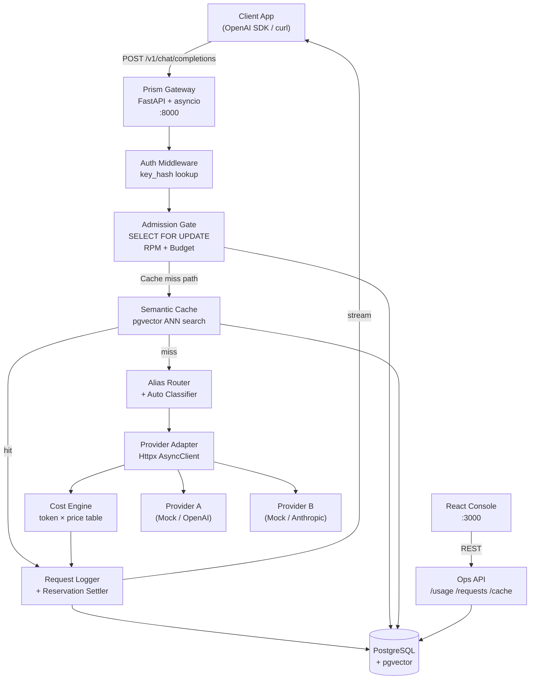
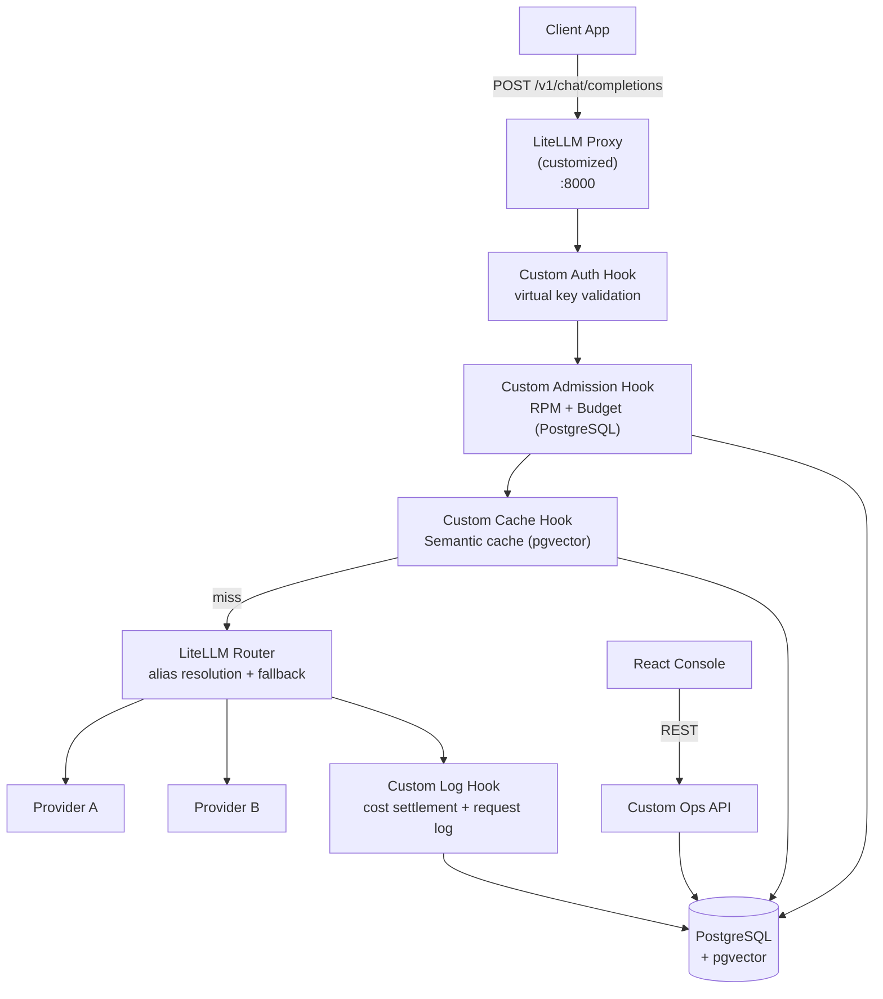
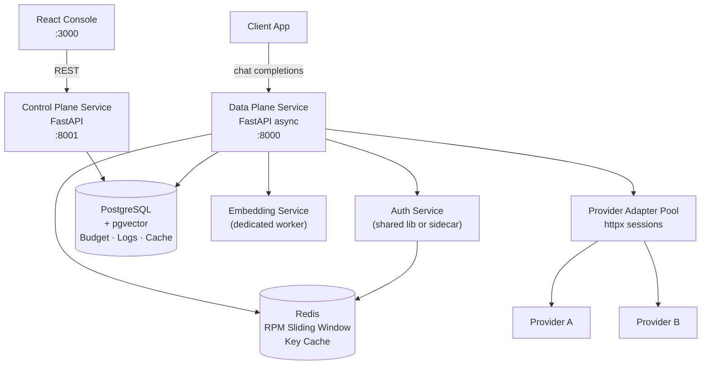

# High Level Design — Prism: LLM Gateway and Semantic Cache

> This document presents **three distinct implementation approaches** for Prism. After reviewing, choose one — or indicate if you want a hybrid — before proceeding to `Architecture.md`.

---

## System Overview

Prism is a multi-tenant LLM gateway that sits between client applications and upstream model providers. Every request flows through a fixed pipeline:

```
Client → [Auth] → [Admission] → [Cache Lookup] → [Routing] → [Provider] → [Logging] → Client
```

The same pipeline applies for both streaming and non-streaming responses, with the streaming path requiring a persistent SSE pass-through channel.

---

## Core Subsystems (Common to All Approaches)

| Subsystem | Responsibility |
|---|---|
| **Auth** | Validate virtual key (hash lookup), check allowlist |
| **Admission** | Atomically enforce RPM limit + budget reservation |
| **Router** | Resolve alias → primary/fallback chain; `auto` → classifier |
| **Cache** | Embedding-similarity lookup and store, scoped per key |
| **Provider Adapter** | Per-provider HTTP client with timeout, retry, SSE pass-through |
| **Cost Engine** | Compute cost from token counts + pricing table |
| **Logger** | Persist request log + provider attempts + settle reservation |
| **Ops API** | Usage summary, recent requests, cache hit rate |
| **Console** | Simple React frontend over Ops API |

---

## Approach A — Custom Async Monolith (Recommended by Airtribe)

### Philosophy
Single Python async service (FastAPI + asyncio) with PostgreSQL as the single durable store. All gateway logic is owned, visible, and directly testable. No external message queues or caches — PostgreSQL handles everything including the semantic cache via `pgvector`.

### Architecture Diagram



### Request Flow

```mermaid
sequenceDiagram
    participant C as Client
    participant GW as Gateway
    participant PG as PostgreSQL
    participant Emb as Embedding Model
    participant P as Provider

    C->>GW: POST /v1/chat/completions (virtual_key)
    GW->>PG: SELECT key WHERE hash=$h (auth)
    GW->>PG: BEGIN; SELECT FOR UPDATE admission_counters; (RPM+budget check)
    GW->>PG: INSERT budget_reservations; UPDATE counters; COMMIT;
    GW->>Emb: embed(prompt)
    GW->>PG: ANN search cache_entries WHERE key_id=$k
    alt Cache HIT (similarity >= threshold)
        GW->>C: return cached response (x-prism-cache: hit)
        GW->>PG: UPDATE cache hit_count; INSERT request_log
    else Cache MISS
        GW->>GW: resolve alias → provider/model (+ auto classify)
        GW->>P: POST /chat/completions (stream or non-stream)
        P-->>GW: stream tokens
        GW-->>C: SSE pass-through
        GW->>PG: INSERT request_log, provider_attempts
        GW->>PG: UPDATE admission_counters (settle reservation)
        GW->>PG: INSERT cache_entries (embed + store)
    end
```

### Tech Stack

| Component | Technology |
|---|---|
| Gateway API | Python 3.12, FastAPI, uvicorn |
| Async HTTP | httpx (AsyncClient) |
| Database | PostgreSQL 16 + pgvector |
| ORM / Queries | SQLAlchemy Core async + asyncpg |
| Embeddings | OpenAI `text-embedding-3-small` or local `sentence-transformers` |
| Auto Classifier | Lightweight LLM call or heuristic model (validated on eval set) |
| Frontend | React + Vite (simple, vibe-coding fine) |
| Config | Pydantic Settings, `.env` |
| Testing | pytest + pytest-asyncio + httpx AsyncClient |

### Pros
- ✅ Full ownership of admission, routing, cache, and accounting logic
- ✅ Fewest moving parts — one service, one database
- ✅ Easiest to test, debug, and demonstrate
- ✅ Atomic admission is straightforward with PostgreSQL row locking
- ✅ `pgvector` ANN search fits naturally alongside other tables
- ✅ Assessment criteria directly visible — no abstracted framework magic

### Cons
- ❌ Vertical scaling only (single service); throughput limited by Python GIL and DB connections
- ❌ All concerns live in one codebase — no separation of data plane vs. control plane
- ❌ Under extreme load, DB becomes the bottleneck for both admission and cache lookups

### Best For
Capstone delivery with clear, demonstrable ownership of every critical engineering decision. **This is the approach Airtribe recommends.**

---

## Approach B — Extend LiteLLM + Custom Hooks

### Philosophy
Use **LiteLLM** as the provider abstraction and routing engine. Layer custom middleware for virtual key auth, admission control, semantic cache, cost accounting, and logging as hooks around LiteLLM's existing call path.

### Architecture Diagram



### Key Integration Points

LiteLLM's proxy exposes hook points for:
- **`pre_call_hook`** — auth + admission
- **`post_call_hook`** — logging + settlement + cache store
- **Custom middleware** — cache lookup before LiteLLM routing

```python
# Custom admission hook example
async def pre_call_hook(user_api_key_dict, cache, data, call_type):
    key = await get_virtual_key(user_api_key_dict.api_key)
    await atomic_admit(key)           # PostgreSQL FOR UPDATE
    data["metadata"]["reservation_id"] = reservation.id
    return data
```

### Tech Stack

| Component | Technology |
|---|---|
| Gateway Core | LiteLLM Proxy (`litellm[proxy]`) |
| Auth/Admission Hooks | Custom Python middleware |
| Semantic Cache | Custom hook + PostgreSQL + pgvector |
| Cost Accounting | Custom hook (overrides LiteLLM's cost tracking) |
| Config | LiteLLM `config.yaml` + custom `.env` |
| Database | PostgreSQL 16 + pgvector |
| Frontend | React + Vite |
| Testing | pytest + LiteLLM test utilities |

### Compatibility Constraints
- Must demonstrate `x-prism-provider`, `x-prism-cache`, `x-prism-fallback`, `x-prism-cost-usd` headers
- LiteLLM's internal cost accounting must be **bypassed or validated** — it uses its own token counting which may diverge from provider-reported counts
- LiteLLM's streaming pass-through behavior must be verified against `smoke_test.py`
- Virtual key management must be reimplemented — LiteLLM's key system doesn't match Prism's schema

### Pros
- ✅ Provider adapters (OpenAI, Anthropic, etc.) come for free
- ✅ LiteLLM's retry/fallback logic is already battle-tested
- ✅ Less provider boilerplate to write

### Cons
- ❌ Framework magic makes assessment-critical logic harder to demonstrate and test
- ❌ LiteLLM's internal accounting may conflict with Prism's exact requirements
- ❌ Hook system limits where custom logic can be injected (pre/post, not mid-stream)
- ❌ Harder to control streaming backpressure and disconnect handling
- ❌ Additional verification burden to prove compliance with the test suite
- ❌ LiteLLM version upgrades can break custom hooks unexpectedly

### Best For
Teams that want faster provider onboarding and are willing to invest in validating compatibility with every assessment test.

---

## Approach C — Layered Microservices with Redis Admission

### Philosophy
Split Prism into **distinct services** with clear boundaries: a data plane (completions), a control plane (key management, usage), and shared infrastructure (Redis for admission speed, PostgreSQL for durability). Redis handles sub-millisecond rate limit checks; PostgreSQL handles durable accounting and semantic cache.

### Architecture Diagram



### Service Responsibilities

| Service | Owns |
|---|---|
| **Data Plane** | `/v1/chat/completions`, streaming, provider dispatch, SSE |
| **Control Plane** | Key CRUD, usage API, ops API, budget reports |
| **Auth Layer** | Key hash lookup (Redis cache → PostgreSQL fallback) |
| **Redis** | Sliding window RPM counters, hot key metadata cache |
| **PostgreSQL** | Budget reservations, request logs, semantic cache, pricing |
| **Embedding Worker** | Async embedding generation for cache miss path |

### Admission Protocol (Redis + PostgreSQL)

```
1. RPM check: Redis INCR key:<id>:rpm:<window> with EXPIRY
2. Budget check: PostgreSQL FOR UPDATE (admission_counters)
3. If both pass: reserve in PostgreSQL, record in Redis
4. Provider call (no locks held)
5. Settle: PostgreSQL UPDATE + Redis DECRBY reserved
```

### Tech Stack

| Component | Technology |
|---|---|
| Data Plane | Python 3.12, FastAPI, uvicorn |
| Control Plane | Python 3.12, FastAPI |
| Async HTTP | httpx (AsyncClient) |
| RPM Admission | Redis 7 (INCR + sliding window) |
| Budget + Logs | PostgreSQL 16 + pgvector |
| Key Cache | Redis (5-min TTL for hot keys) |
| Embeddings | Dedicated async worker or background task |
| Frontend | React + Vite |
| Orchestration | Docker Compose (dev), or single-host |

### Pros
- ✅ Redis INCR for RPM is atomic and extremely fast (sub-ms)
- ✅ Separation of data plane and control plane enables independent scaling
- ✅ Key metadata caching in Redis reduces DB reads on hot paths
- ✅ Embedding generation can be parallelized without blocking request path
- ✅ Cleaner service boundaries — easier to evolve independently

### Cons
- ❌ Two additional infrastructure components (Redis + embedding worker) to manage
- ❌ Distributed consistency: Redis (RPM) and PostgreSQL (budget) must stay in sync — split-brain scenarios are possible
- ❌ Significantly more complex to set up, test, and demo than a single service
- ❌ Over-admission risk if Redis and PostgreSQL admission checks are not carefully coordinated
- ❌ More infrastructure to explain in demo and documentation

### Best For
Production-scale deployments or teams that want to demonstrate distributed systems knowledge. **Higher complexity; harder to get perfectly right in a capstone context.**

---

## Approaches at a Glance

| Dimension | Approach A (Custom Monolith) | Approach B (LiteLLM) | Approach C (Microservices) |
|---|---|---|---|
| **Complexity** | Low-Medium | Medium | High |
| **Ownership** | Full | Partial | Full |
| **Provider adapters** | Write yourself | Free via LiteLLM | Write yourself |
| **Admission atomicity** | PostgreSQL FOR UPDATE | PostgreSQL FOR UPDATE | Redis + PostgreSQL |
| **Streaming control** | Full | Framework-limited | Full |
| **Semantic cache** | pgvector in same DB | pgvector (custom hook) | pgvector in same DB |
| **Demo clarity** | Highest | Medium | Medium |
| **Test compliance risk** | Lowest | Medium-High | Low |
| **Infrastructure deps** | PostgreSQL only | PostgreSQL | PostgreSQL + Redis |
| **Assessment visibility** | Highest | Medium | High |
| **Recommended for capstone** | ✅ **Yes** | ⚠️ Risky | ⚠️ Over-engineered |

---

## Possible Hybrid Approaches

If you want to mix elements, here are natural combinations:

### Hybrid A+C (Recommended if you want Redis)
- Use Approach A's monolith structure and PostgreSQL-only architecture
- Replace PostgreSQL sliding window RPM with **Redis INCR** for speed
- Keep PostgreSQL as the single source of truth for budget and logs
- Complexity: **Medium** | Benefit: faster rate limit checks under load

### Hybrid A+B (Provider Adapters only from LiteLLM)
- Use Approach A for all gateway logic (auth, admission, cache, logging)
- Use LiteLLM's **SDK** (not proxy) only for provider HTTP calls
- Keep full ownership of the request pipeline
- Complexity: **Low-Medium** | Benefit: fewer provider adapter lines to write

---

## Recommended Decision

> [!IMPORTANT]
> **Start with Approach A.** It gives you full ownership of every assessment-critical logic path, the clearest demo story, and the lowest compliance risk with `smoke_test.py`. PostgreSQL with `pgvector` handles everything — no additional infrastructure needed.
>
> If you find RPM rate limiting is a bottleneck during load testing, bolt on **Redis for RPM counters only** (Hybrid A+C) as a targeted optimization — not a full architectural change.

---

*→ Next: Share your decision and proceed to `Architecture.md` for component-level design and `implementationPlan.md` for phased execution.*

