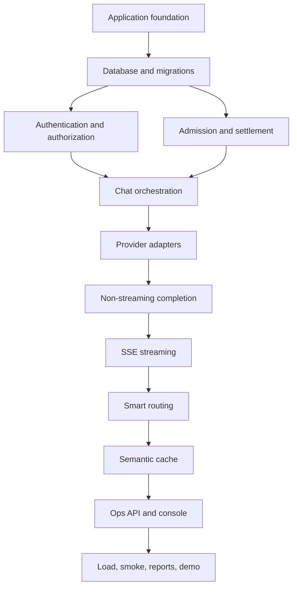

# Implementation Plan — Prism LLM Gateway and Semantic Cache

> **Delivery model:** Five phases across ten focused development days  
> **Architecture:** Modular FastAPI monolith with ports and adapters  
> **Primary datastore:** PostgreSQL 16 with pgvector  
> **Execution principle:** Correctness and verification before feature breadth

---

## 1. Purpose

This plan converts the accepted architecture into an ordered implementation backlog. It is designed to produce a working, explainable, and testable capstone rather than a collection of disconnected features.

Each phase ends with a usable increment and a verification gate. Work should not move to the next phase while the current phase has failing critical tests or violates an operational invariant from `Architecture.md`.

The ten-day schedule is a planning baseline, not permission to skip verification. If a phase takes longer, preserve the dependency order and reduce optional scope before reducing correctness.

---

## 2. Delivery Principles

1. **Build vertical slices.** Each milestone should exercise the API, application service, port, adapter, and database path where applicable.
2. **Test critical rules first.** Admission, settlement, tenant isolation, and stream commitment receive tests before optimization or UI polish.
3. **Keep external systems replaceable.** Core application services depend on provider, embedding, repository, clock, and identifier ports.
4. **Use mocks over paid dependencies.** Two HTTP mock providers are sufficient for the core demonstration and make failure scenarios deterministic.
5. **Keep transactions short.** No provider or embedding network call occurs while a database transaction is holding a row lock.
6. **Prefer exact behaviour initially.** Exact tenant-filtered vector search comes before approximate ANN indexing.
7. **Record evidence.** Smoke tests, concurrency results, routing evaluation, and accounting totals become project artifacts.
8. **Document while building.** Update setup instructions and decision records with each completed phase.

---

## 3. Definition of Done for the Project

The project is complete only when all of the following are true:

- `POST /v1/chat/completions` supports validated non-streaming and streaming requests.
- At least two provider targets are available through a common adapter contract.
- Virtual-key authentication, alias authorization, RPM enforcement, and monthly budgets work under concurrency.
- Admission reserves cost before billable work and settlement occurs exactly once.
- `fast`, `smart`, and `auto` aliases resolve correctly.
- Smart routing beats the documented length-only baseline on the labeled evaluation set.
- Retries and ordered failover work before stream commitment.
- Failover never occurs after client-visible streaming content.
- Successful streams terminate with `data: [DONE]`; failed partial streams do not.
- Semantic cache hits work for validated paraphrases and never cross tenant or configuration boundaries.
- Required `x-prism-*` headers are returned with documented streaming semantics.
- Usage and recent-request APIs are implemented.
- The React console shows usage, recent requests, cache statistics, and fallback activity.
- Automated tests cover domain policies, database transactions, provider contracts, concurrency, and end-to-end flows.
- Smoke and load scripts produce reproducible reports.
- Docker Compose starts the complete local demonstration environment.
- README and project documentation explain setup, architecture, limitations, and demonstration steps.

---

## 4. Target Repository Structure

```text
CapstoneProjectAirtribe/
├── backend/
│   ├── pyproject.toml
│   └── src/prism/
│       ├── main.py
│       ├── api/
│       ├── application/
│       ├── domain/
│       ├── ports/
│       ├── adapters/
│       └── infrastructure/
├── frontend/
├── migrations/
├── config/
├── mock-providers/
├── scripts/
├── tests/
│   ├── unit/
│   ├── integration/
│   ├── contract/
│   ├── concurrency/
│   └── end_to_end/
├── Docs/
├── docker-compose.yml
└── README.md
```

---

## 5. Phase Overview

| Phase | Days | Outcome | Verification gate |
|---|---:|---|---|
| 1. Foundation and persistence | 1–2 | Bootable service, database, migrations, seeds | Clean startup, health checks, migration tests |
| 2. Security and atomic accounting | 3–4 | Auth, authorization, RPM, reservation, settlement | Concurrency proves zero over-admission |
| 3. Provider execution and streaming | 5–6 | Provider adapters, retries, failover, SSE | Provider contract and stream-failure tests pass |
| 4. Intelligent routing and semantic cache | 7–8 | `auto` routing, eval harness, tenant-safe cache | Routing beats baseline; isolation tests pass |
| 5. Operations, hardening, and delivery | 9–10 | Ops APIs, console, reconciliation, reports, docs | Full smoke test and demonstration rehearsal |

---

## 6. Phase 1 — Foundation and Persistence

### Goal

Create a reproducible local environment and a clean backend skeleton that can evolve without reorganizing the project later.

### Day 1 — Project scaffolding and application lifecycle

#### Tasks

- Create `backend/pyproject.toml` with pinned compatible dependency ranges.
- Configure the `src/` package layout.
- Add FastAPI application creation and lifespan management.
- Add settings loading with environment-variable validation.
- Define configuration groups for:
  - Application and logging.
  - PostgreSQL connection and pool.
  - Provider timeouts and retry limits.
  - Cache policy and similarity threshold.
  - Authentication pepper and admin credentials.
- Add structured JSON logging with secret redaction.
- Add correlation/request ID generation.
- Add `/health/live` and `/health/ready` endpoints.
- Create API, application, domain, ports, adapters, and infrastructure packages.
- Configure code-quality tools:
  - Ruff for formatting and linting.
  - Mypy or Pyright for static type checks.
  - Pytest and pytest-asyncio for tests.
- Add a minimal CI workflow for lint, type checks, and tests.

#### Tests

- Application factory creates an app without external network calls.
- Invalid required configuration fails at startup with a safe message.
- Liveness succeeds without checking dependencies.
- Readiness fails when PostgreSQL is unavailable.
- Logs do not expose configured secrets.

#### Deliverable

A bootable backend with no business features yet, clear module boundaries, and automated quality checks.

### Day 2 — PostgreSQL, migrations, and seed loading

#### Tasks

- Add Docker Compose services for PostgreSQL 16 with pgvector.
- Configure SQLAlchemy async engine and session lifecycle.
- Configure Alembic migrations.
- Update the proposed data model before generating the first migration:
  - Support invalid-key security events separately from tenant request logs.
  - Add `in_progress` and partial-stream terminal states.
  - Make reservation settlement idempotent.
  - Add reconciliation fields.
  - Model alias permissions with referential integrity.
  - Treat `auto` as a routing policy rather than a physical provider target.
  - Add cache and embedding schema versions.
- Create the initial migration and indexes.
- Add `model_pricing.json`, `seed_keys.json`, and `gateway_config.sample.json`.
- Implement idempotent seed loading.
- Add repository ports and PostgreSQL adapter foundations.
- Add test fixtures for isolated database transactions.

#### Tests

- Migrations apply to an empty database.
- Migrations can be reapplied in a fresh environment.
- pgvector extension is available.
- Seed loading creates expected providers, aliases, pricing, and keys.
- Re-running seeds does not duplicate records.
- Monetary columns preserve decimal precision.
- Repository queries use parameter binding.

#### Phase 1 definition of done

- `docker compose up` starts PostgreSQL and the gateway.
- Liveness and readiness behave correctly.
- The database can be created entirely from migrations and seeds.
- No secrets are committed or printed.
- Lint, type checks, unit tests, and migration tests pass.

---

## 7. Phase 2 — Security and Atomic Accounting

> **Status:** Completed and verified on 2026-11-11. The Python 3.12/PostgreSQL suite has 32 passing tests with 85.21% coverage, including concurrent budget-admission and exactly-once settlement tests.

### Goal

Implement the correctness foundation: tenant identity, access rules, admission, reservation, and exactly-once settlement.

### Day 3 — Authentication and authorization

#### Tasks

- Define domain models for virtual keys and tenant context.
- Implement virtual-key digesting with HMAC-SHA-256 and a server-side pepper.
- Preserve seed compatibility if the supplied key format requires a documented digest mode.
- Implement authentication repository lookup.
- Reject missing, invalid, inactive, and expired keys distinctly.
- Implement alias allowlist authorization.
- Add an API dependency that extracts the bearer key without logging it.
- Implement stable OpenAI-style error bodies.
- Record safe security events for invalid-key attempts.
- Add separate admin authentication for future ops routes.

#### Tests

- Valid key authenticates.
- Unknown, inactive, and expired keys fail with correct status and code.
- Requested aliases are allowed or rejected correctly.
- Raw keys and authorization headers never appear in logs.
- A tenant key cannot act as an admin key.
- Timing-safe digest comparison or indexed digest lookup is used appropriately.

#### Deliverable

An authenticated API boundary with explicit tenant context and model-alias authorization.

### Day 4 — Admission, reservations, and settlement

#### Tasks

- Define cost-estimation and monetary domain types using `Decimal`.
- Implement pricing lookup by provider, model, and effective time.
- Calculate a conservative request estimate.
- Implement the short admission transaction:
  - Lock the tenant admission row.
  - Roll the RPM window when required.
  - Roll the monthly budget counter when required.
  - Validate RPM and available budget.
  - Increment request count.
  - Create a pending reservation.
  - Create an in-progress request record.
- Implement distinct RPM and budget rejection errors.
- Implement idempotent reservation settlement.
- Implement reservation release for non-billable failures.
- Add a test clock for deterministic window/month tests.
- Add database lock and statement timeouts.

#### Tests

- Cost calculations preserve decimal precision.
- Requests below limits are admitted.
- Requests beyond RPM or budget are rejected before external work.
- RPM window resets at the expected time.
- Monthly budget rolls over correctly.
- Settlement changes `pending` only once.
- Repeated settlement calls do not double-charge or double-release.
- Concurrent requests against one key never over-admit the budget.
- Requests for different tenants do not unnecessarily serialize.
- No database transaction remains open during a simulated external call.

#### Phase 2 definition of done

- Authentication and allowlist enforcement are complete.
- Admission and settlement invariants have focused integration tests.
- A concurrency test demonstrates zero budget over-admission.
- Every admitted request has one reservation and one request record.
- No billable work can begin without a committed reservation.

---

## 8. Phase 3 — Provider Execution and Streaming

> **Status:** Completed and verified on 2026-11-12. The Python 3.12/PostgreSQL suite has 43 passing tests with 81.41% coverage. Live Docker checks prove primary execution, retries and ordered fallback, clean SSE completion, no fallback after stream commitment, conservative partial-stream settlement, and non-billable fatal release.

### Goal

Deliver the gateway's primary user-facing capability with real HTTP provider boundaries, observable attempts, safe retries, ordered failover, and true SSE pass-through.

### Day 5 — Provider contract and non-streaming execution

#### Tasks

- Define canonical provider request, response, usage, and error models.
- Define the `ProviderAdapter` port.
- Create one application-scoped `httpx.AsyncClient` with connection pooling.
- Configure connect, read, write, pool, and total attempt limits.
- Implement two independent OpenAI-compatible HTTP mock providers.
- Give mocks deterministic controls for:
  - Success.
  - Latency.
  - Timeout.
  - HTTP 429.
  - HTTP 500/503.
  - Malformed body.
  - Token usage.
- Implement the OpenAI-compatible provider adapter.
- Implement provider-attempt persistence.
- Implement bounded exponential backoff with jitter.
- Implement ordered fallback chains.
- Implement non-streaming `/v1/chat/completions` orchestration.
- Return required Prism headers.

#### Tests

- Both mock providers satisfy the same adapter contract.
- Successful responses normalize to the canonical response.
- Token usage and cost are recorded accurately.
- Retryable and fatal errors are classified correctly.
- Retry count and total duration are bounded.
- Fallback order is deterministic.
- Every physical call creates a provider-attempt record.
- Final reservation settlement matches actual usage.

#### Deliverable

A working non-streaming OpenAI-compatible completion endpoint with provider retry, failover, headers, logs, and accounting.

### Day 6 — SSE streaming and cancellation

#### Tasks

- Implement upstream SSE parsing and validation.
- Implement downstream `StreamingResponse` pass-through.
- Preserve backpressure by yielding chunks rather than buffering the response.
- Track `stream_committed` after the first client-visible content frame.
- Permit retry/failover only while `stream_committed=false`.
- Cancel and close the upstream response after client disconnect.
- Emit `[DONE]` only after clean upstream completion.
- Record partial-stream failures without `[DONE]`.
- Capture provider usage when available.
- Apply a documented conservative reconciliation rule when final usage is unavailable.
- Define streaming cost-header semantics as reserved estimate.
- Settle in cancellation-safe cleanup logic.

#### Tests

- Tokens reach the client incrementally.
- The complete response is not buffered in gateway memory.
- A pre-content failure can fail over.
- A post-content failure never retries or fails over.
- Clean completion emits one `[DONE]` sentinel.
- Partial failure emits no `[DONE]` sentinel.
- Client disconnect closes the upstream stream.
- Cancellation still reaches one terminal settlement path.
- Streaming response headers match the documented contract.

#### Phase 3 definition of done

- Non-streaming and streaming requests work through both mock providers.
- Retry and fallback behaviour is fully observable.
- Stream commitment rules are enforced by automated tests.
- HTTP connections are closed on success, failure, and cancellation.
- Provider usage is settled accurately or flagged for reconciliation.

---

## 9. Phase 4 — Intelligent Routing and Semantic Cache

> **Status:** Completed and verified on 2026-11-12. The Python 3.12/PostgreSQL suite has 55 passing tests with 80.89% branch coverage. The committed `rules-v1` classifier scores 100% versus 40% for the length-only baseline, and live Docker checks prove tenant-policy routing, paraphrase hits, negative/configuration/cross-tenant isolation, zero-cost cache settlement, persisted telemetry, and valid cached SSE completion.

### Goal

Add Prism's AI-first behaviour without weakening tenant isolation, accounting, or deterministic testing.

### Day 7 — Smart routing and evaluation

#### Tasks

- Define routing policy and classifier ports.
- Implement deterministic `fast` and `smart` alias resolution.
- Implement a versioned `auto` classifier.
- Begin with an explainable feature/rule classifier or a small local model.
- Return tier, reason code, confidence, and classifier version.
- Create labeled routing evaluation cases including:
  - Short difficult reasoning prompts.
  - Long but trivial prompts.
  - Coding and analysis prompts.
  - Simple extraction and summarization prompts.
- Implement a length-only baseline.
- Add `scripts/routing_eval.py`.
- Persist routing decisions with request logs.
- Include classifier cost in reservations if the classifier is externally billed.

#### Tests and evaluation

- `fast` and `smart` resolve predictably.
- `auto` respects the tenant's allowed routing policy.
- Classifier decisions are deterministic under test configuration.
- Evaluation reports accuracy per case, trap-case accuracy, and baseline comparison.
- Smart routing exceeds the length-only baseline on the committed dataset.

#### Deliverable

An explainable `auto` route with reproducible evidence that it improves over a trivial baseline.

### Day 8 — Semantic cache

#### Tasks

- Define the embedding-provider port.
- Implement a deterministic local embedding adapter for tests and demos.
- Validate embedding dimension and model version.
- Implement canonical request serialization.
- Include full conversation and all response-affecting options in `scope_hash`.
- Implement cache eligibility rules.
- Implement exact tenant- and scope-filtered cosine search.
- Enforce TTL and similarity threshold.
- Add cache-hit accounting and hit counters.
- Store only complete, successful, eligible responses.
- Return cached JSON for non-streaming requests.
- Transform cached responses into valid SSE for streaming requests.
- Add positive paraphrase and negative near-miss evaluation cases.

#### Tests

- Exact repeat produces a hit.
- Approved paraphrase produces a hit above threshold.
- Negative near-miss does not produce a false hit.
- Different virtual keys never share cache entries.
- Different system messages, tools, or generation settings never share cache entries.
- Expired entries are ignored.
- Partial streams and tool-call responses are not cached initially.
- Streaming cache hits emit valid chunks and `[DONE]`.
- Cache-hit settlement releases unused provider reservation correctly.

#### Phase 4 definition of done

- Routing evaluation beats the committed baseline.
- Cache threshold evidence includes positive and negative cases.
- Cross-tenant and configuration isolation tests pass.
- Cached responses preserve the requested transport format.
- Cache behaviour is visible through response headers and request logs.

---

## 10. Phase 5 — Operations, Hardening, and Delivery

> **Status:** Completed and verified on 2026-11-12. The final Python 3.12/PostgreSQL suite has 61 passing tests with 82.62% branch coverage; Ruff, strict Mypy, the React/TypeScript production build, the nine-path smoke suite, bounded load test, accounting reconciliation, isolated clean-volume Docker Compose startup, and responsive console inspection all pass.

> **Provider update:** Normal `fast` and `smart` traffic now uses Groq's OpenAI-compatible API through `GROQ_API_KEY`. The explicit `mock-fast` alias preserves deterministic retry/fallback demonstrations and offline contract testing without exposing the Groq secret to clients.

### Goal

Turn the working gateway into a reproducible capstone submission with operational visibility, recovery behaviour, verified performance, and a clear demonstration story.

### Day 9 — Ops APIs, console, and recovery

#### Tasks

- Implement admin-protected usage-summary API.
- Implement paginated recent-request API.
- Implement cache-statistics and provider-attempt APIs.
- Add filters for tenant, date, status, provider, cache result, and fallback.
- Build React + Vite console pages for:
  - Usage and spend by key.
  - Recent requests.
  - Cache hit rate.
  - Provider failures and fallback events.
- Add loading, empty, and error states.
- Add explicit CORS allowlist.
- Implement stale-reservation reconciliation.
- Protect the reconciler with a PostgreSQL advisory lock.
- Add structured metrics for requests, latency, cache, attempts, fallbacks, and settlement failures.
- Add readiness checks for required dependencies.

#### Tests

- Tenant keys cannot access ops APIs.
- Admin credentials can access only intended endpoints.
- Pagination and filters are bounded and correct.
- Console does not expose secrets or complete key hashes.
- One reconciler runs across multiple simulated instances.
- Clearly abandoned reservations are released safely.
- Ambiguous billable attempts are flagged rather than silently discarded.

#### Deliverable

An operations surface that explains what the gateway is doing and a recovery path for reservations left pending by process failure.

### Day 10 — Verification, documentation, and demonstration

#### Tasks

- Complete `scripts/smoke_test.py`.
- Complete concurrency/load test script.
- Produce routing evaluation report.
- Produce cache-threshold evaluation report.
- Produce accounting reconciliation report.
- Run the complete automated suite in a clean environment.
- Verify Docker Compose startup from a fresh clone.
- Write README sections for:
  - Project overview.
  - Architecture.
  - Setup and configuration.
  - Seed keys and demo commands.
  - API examples.
  - Streaming behaviour.
  - Routing and failover.
  - Cache scoping.
  - Testing and verification.
  - Known limitations.
- Update knowledge-transfer documentation.
- Prepare an explainer-video script.
- Rehearse the demonstration in the exact intended order.
- Record evidence outputs under a documented reports directory.

#### Required demonstration order

1. Start the environment with Docker Compose.
2. Show a successful non-streaming request.
3. Show token-by-token streaming and `[DONE]`.
4. Show `auto` routing for easy and difficult prompts.
5. Force the primary provider to fail and show fallback.
6. Show a paraphrased semantic-cache hit.
7. Prove another tenant cannot receive the cached response.
8. Trigger RPM rejection.
9. Trigger budget rejection.
10. Show usage, cache, and fallback records in the console.

#### Phase 5 definition of done

- Full automated suite passes from a clean checkout.
- Smoke tests pass against the Docker Compose environment.
- Concurrency report shows zero over-admission.
- Routing report shows improvement over baseline.
- Cache evaluation documents threshold trade-offs honestly.
- Accounting report reconciles reservations, attempts, and spend.
- README enables another developer to run the project without undocumented steps.
- Demo can be completed without manually modifying the database.

---

## 11. Verification Matrix

| Requirement | Primary verification |
|---|---|
| OpenAI-compatible endpoint | Contract and smoke tests |
| Two providers | Shared adapter contract suite |
| Virtual keys | Authentication integration tests |
| Alias allowlist | Authorization unit/integration tests |
| RPM limit | Clock-controlled and concurrency tests |
| Monthly budget | Reservation and load tests |
| Smart routing | Labeled evaluation vs. baseline |
| Retry and failover | Mock-provider failure scenarios |
| Streaming | Incremental SSE and disconnect tests |
| Semantic cache | Paraphrase/near-miss and isolation tests |
| Cost accounting | Pricing unit tests and reconciliation report |
| Required headers | Non-streaming, streaming, cache, fallback tests |
| Usage APIs | Repository and API integration tests |
| Ops console | Component checks and end-to-end demo |

---

## 12. Test Commands and Quality Gates

The exact commands may be adjusted to the chosen package runner, but the project should expose stable developer commands equivalent to:

```text
format          Format source files
lint            Run Ruff lint checks
typecheck       Run static type checking
test-unit       Run fast domain and application tests
test-integration Run PostgreSQL and adapter integration tests
test-contract   Run provider contract tests
test-concurrency Run admission and settlement concurrency tests
test-e2e        Run end-to-end API scenarios
test            Run the complete test suite
smoke           Run the deployed smoke test
```

### Pull-request gate

A change is mergeable when:

- Formatting, lint, and type checks pass.
- Relevant unit and integration tests pass.
- New business behaviour has tests.
- Database changes include migrations.
- No secret or generated credential is committed.
- Architecture invariants remain intact.
- Documentation changes accompany externally visible behaviour.

---

## 13. Risk Register

| Risk | Impact | Mitigation | Trigger for escalation |
|---|---|---|---|
| Budget race condition | Hard budget violation | Row lock, reservation, concurrency tests | Any over-admission in load tests |
| Double settlement | Incorrect spend | Conditional state transition and idempotency tests | Counter differs from settled reservations |
| Stale reservation | Tenant budget remains blocked | Reconciler and crash tests | Pending age exceeds configured threshold |
| Streaming resource leak | Connection pool exhaustion | Cancellation-safe close and active-stream metric | Open connections grow after completed tests |
| Failover after stream starts | Corrupted client response | Explicit commitment state and fault injection | Second provider called after emitted content |
| Cache tenant leak | Security incident | Tenant-required repository API and isolation tests | Any cross-key cache candidate is returned |
| Cache false positive | Incorrect answer | Conservative threshold and negative evaluation set | Near-miss hit rate exceeds accepted target |
| Classifier underperforms | Feature fails assessment | Versioned eval set and explainable baseline | Accuracy does not beat length baseline |
| Provider usage absent | Accounting uncertainty | Conservative estimate and reconciliation flag | Partial stream lacks final usage |
| Database hot-row contention | High latency | Measure lock wait; optimize only with evidence | Admission latency exceeds target under load |
| Scope growth | Missed delivery | Protect critical path; defer optional integrations | Core Phase 3 work slips into final phase |

---

## 14. Scope Priorities

### Must have

- Authentication and alias authorization.
- Atomic RPM and budget admission.
- Reservation and exactly-once settlement.
- Two mock providers.
- Non-streaming and streaming completions.
- Pre-commit retry and failover.
- `auto` routing with evaluation.
- Tenant-safe semantic cache.
- Usage APIs and a minimal console.
- Smoke, concurrency, routing, and isolation evidence.

### Should have

- Reservation reconciler.
- Structured metrics and trace-ready instrumentation.
- Cache threshold evaluation report.
- Provider health visibility.
- Polished Docker Compose developer experience.

### Could have after the core is complete

- Optional real-provider configuration.
- HNSW indexing for a measured large cache.
- OpenTelemetry exporter configuration.
- Circuit breaker based on observed provider health.
- More advanced console charts.
- Per-tenant cache policy controls.

### Explicitly out of initial scope

- Redis or distributed admission.
- Kubernetes deployment.
- Multiple independently deployed backend services.
- A custom model-training pipeline.
- Enterprise identity management.
- Cross-tenant shared semantic cache.

---

## 15. Progress Tracking Template

Use this checklist at the end of each development day:

```text
Date:
Phase / day:

Completed:
-

Tests added or updated:
-

Verification results:
-

Decisions made:
-

Known risks or blockers:
-

Next task:
-
```

Commits should be small enough to describe one coherent change, such as:

```text
chore: scaffold FastAPI application and quality tools
feat: add atomic admission and budget reservation
feat: stream provider SSE with disconnect cleanup
test: prove cache isolation across virtual keys
docs: record routing evaluation results
```

---

## 16. Dependency Order



The ordering is intentional. The UI is not allowed to become a substitute for unfinished accounting, streaming, or tenant-isolation behaviour.

---

## 17. Final Handover Artifacts

At delivery, the repository should contain:

- Working backend and frontend source.
- Versioned migrations.
- Seed and sample configuration files.
- Two deterministic mock providers.
- Unit, integration, contract, concurrency, and end-to-end tests.
- Smoke and load scripts.
- Routing and cache evaluation datasets.
- Verification reports with raw command output or summarized evidence.
- Architecture and implementation documents.
- Complete README.
- Demo script and known-limitations section.

---

## 18. Related Documents

- [`problemStatement.md`](./problemStatement.md) — functional and non-functional requirements.
- [`HLD.md`](./HLD.md) — evaluated architecture choices.
- [`Architecture.md`](./Architecture.md) — accepted component and runtime architecture.
- [`DataModel.md`](./DataModel.md) — initial database design requiring the refinements listed in Phase 1.
- [`KNOWLEDGE_TRANSFER.md`](./KNOWLEDGE_TRANSFER.md) — project status and collaboration handover.

